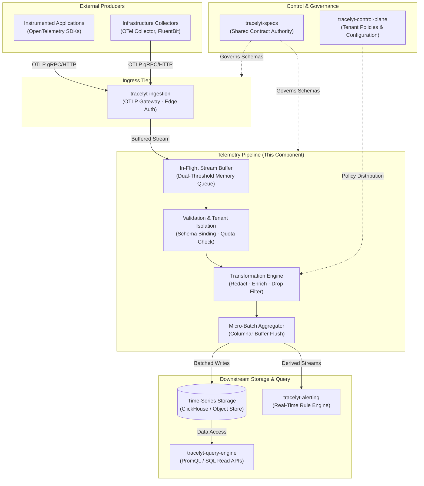

<p align="center">
  
</p>

# Tracelyt Telemetry Pipeline (`tracelyt-telemetry-pipeline`)

The high-throughput telemetry processing, transformation, and routing pipeline foundation for the Tracelyt open-source observability platform.

---

## 1. Project Name and Purpose

**Tracelyt Telemetry Pipeline** is the planned data plane component of the Tracelyt observability platform responsible for processing in-flight operational telemetry—distributed traces, metrics, and application logs—between edge ingestion and downstream persistent storage or query engines.

Its future core purpose is to provide:
- High-efficiency stream buffering and batching.
- In-flight telemetry sanitization, attribute normalization, and privacy redaction.
- Multi-tenant quota enforcement and noisy-neighbor isolation.
- Downstream storage routing and derived real-time alerting signals.

---

## 2. Role of the Telemetry Pipeline in Tracelyt

In the Tracelyt platform architecture, the telemetry pipeline sits directly between the edge ingestion layer (`tracelyt-ingestion`) and persistent columnar storage (ClickHouse, cold object stores, and query engines). 

By isolating complex transformation, regex redaction, and micro-batch aggregation into a dedicated processing tier:
- The edge ingestion gateway remains lightweight, resilient, and focused entirely on protocol termination (OTLP).
- Columnar storage engines are protected from small single-record writes through optimized batching.
- Downstream query performance is enhanced through standardized semantic conventions and normalized attributes.

---

## 3. Current Repository Status

> [!IMPORTANT]
> **Stage: Initial Architecture & Foundation Scaffolding (Pre-1.0)**  
> This repository provides the build system, static analysis, architectural documentation, container definition, and development governance foundation.  
> **Explicit Disclaimers**:
> - No telemetry processing, stream transformations, or routing pipelines are currently active.
> - No message brokers (Kafka, NATS), queues, or database sinks are connected.
> - This is a planned architecture and foundation scaffold, not an operational or deployed production system.
> - No fake status badges, fake coverage metrics, or unsupported claims are made.

---

## 4. What Exists in the Repository Today

- **Buildable Application Bootstrap**: Java 21 LTS + Spring Boot 3.4.3 entry point with Spring `ApplicationContext` smoke test.
- **Build & Quality Tooling**: Maven Wrapper (`mvnw`), pinned plugin versions, and Checkstyle 10.21.4 static analysis with zero violations.
- **Containerization**: Hardened multi-stage non-root `Dockerfile` based on Eclipse Temurin 21 JRE.
- **Comprehensive Documentation**: Complete architectural specifications, failure models, technology strategy, capacity planning, and security threat modeling.
- **Governance & Security**: Code of Conduct, Contributing guide, Security policy, Support guidelines, and Codeowners configuration.

---

## 5. Explicitly Unimplemented Functionality

To maintain strict architectural honesty, the following capabilities are **intentionally not implemented** in this foundation release:
- Kafka producers, consumers, brokers, topics, or partition rebalancing logic.
- Telemetry span enrichment, metric rollups, or log regex redaction algorithms.
- Custom OTLP protocol receivers (OTLP network termination belongs to `tracelyt-ingestion`).
- Database repositories, ClickHouse clients, Redis caches, or storage entities.
- Dead-letter queues or automatic retry/replay state machines.
- Artificial intelligence or LLM-based root cause analysis features.

---

## 6. Architecture Overview

The pipeline operates as a stateless, horizontally scalable data plane worker tier. It receives telemetry batches, applies deterministic transformation and redaction stages within isolated tenant boundaries, and flushes formatted columnar micro-batches downstream.

Detailed architectural specifications:
- [Architecture Overview](docs/architecture/overview.md)
- [System Boundaries](docs/architecture/system-boundaries.md)
- [Technology Strategy](docs/architecture/technology-strategy.md)
- [Failure Model](docs/architecture/failure-model.md)

---

## 7. Planned Telemetry Data Flow

The diagram below illustrates the intended end-to-end data flow across the Tracelyt platform:



*Note: This diagram illustrates planned system architecture; services and stream connections are not yet deployed.*

---

## 8. Component Responsibility Boundaries

| Component | Responsibility Domain |
| :--- | :--- |
| **`tracelyt-ingestion`** | Protocol termination (OTLP gRPC/HTTP), network TLS, edge API key verification, rapid client rate limiting. |
| **`tracelyt-telemetry-pipeline`** | In-flight payload validation, attribute normalization, regex privacy redaction, drop filtering, columnar batching. |
| **`tracelyt-control-plane`** | Platform administration, tenant management, RBAC, API key lifecycle, and policy distribution. |
| **`tracelyt-query-engine`** | Read path execution, PromQL/SQL queries, trace waterfall APIs, and data downsampling. |
| **`tracelyt-alerting`** | Real-time threshold evaluation, incident state tracking, and notification triggers. |
| **`tracelyt-specs`** | Central source of truth for all shared interface contracts and schemas. |

See [System Boundaries](docs/architecture/system-boundaries.md) for detailed boundary definitions.

---

## 9. Technology Strategy

- **Language Foundation**: Java 21 LTS with Spring Boot 3.4.3.
- **Concurrency Model**: Java 21 Virtual Threads (Project Loom) for high-concurrency stream I/O without reactive callback complexity.
- **Polyglot Gate Policy**: Secondary languages (Go, Rust, C++) are deliberately deferred until reproducible profiling demonstrates a clear JVM constraint that cannot be resolved via GC or allocation tuning.
- **Upstream Standards**: Full alignment with upstream CNCF OpenTelemetry Protocol and semantic conventions.

Read the complete rationale in [Technology Strategy](docs/architecture/technology-strategy.md).

---

## 10. Repository Structure

```text
tracelyt-telemetry-pipeline/
├── .github/
│   ├── ISSUE_TEMPLATE/
│   │   ├── bug_report.yml             # Bug report issue template
│   │   ├── feature_request.yml        # Feature request template
│   │   └── config.yml                 # Issue configuration & security links
│   ├── workflows/
│   │   └── ci.yml                     # Continuous integration with pinned action SHAs
│   ├── PULL_REQUEST_TEMPLATE.md       # PR checklist with boundary verification
│   └── CODEOWNERS                     # Repository maintainers review routing
├── assets/
│   └── tracelyt-logo.png              # Official platform centered logo
├── checkstyle/                        # Static analysis configuration (referenced via .checkstyle.xml)
├── docs/
│   ├── architecture/                  # System topology, data flow, failure model, and ADRs
│   ├── development/                   # Local setup, testing strategy, and code style
│   ├── operations/                    # Configuration, observability, and capacity planning
│   ├── security/                      # Threat model, data privacy, and supply chain security
│   └── standards/                     # Contract governance and performance testing
├── src/
│   ├── main/java/io/tracelyt/pipeline/ # Minimal Spring Boot bootstrap entry point
│   ├── main/resources/                # Safe application configuration defaults
│   ├── test/java/io/tracelyt/pipeline/ # Spring context bootstrap smoke tests
│   └── test/resources/                # Test configuration profiles
├── .checkstyle.xml                    # Checkstyle 10.21.4 rules (zero violations)
├── .dockerignore                      # Docker context exclusion rules
├── .editorconfig                      # Cross-editor formatting consistency
├── .env.example                       # Safe environment variable template
├── .gitattributes                     # LF text normalization and binary definitions
├── .gitignore                         # Build and secret file exclusions
├── .java-version                      # Declares Java 21 LTS
├── Dockerfile                         # Multi-stage non-root container image definition
├── pom.xml                            # Maven build descriptor with memory-safe test execution
├── CHANGELOG.md                       # Release and foundation changelog
├── CODE_OF_CONDUCT.md                 # Contributor Covenant v2.1
├── CONTRIBUTING.md                    # Contribution workflow and guidelines
├── LICENSE                            # Official Apache License, Version 2.0
├── NOTICE                             # Apache 2.0 attribution notice
├── README.md                          # Root project documentation
├── SECURITY.md                        # Coordinated vulnerability disclosure policy
├── SUPPORT.md                         # Community discussions and support guidance
└── THIRD_PARTY_NOTICES.md             # Authoritative dependencies and licenses
```

---

## 11. Development Prerequisites

- **Java JDK**: 21 LTS (Eclipse Temurin recommended)
- **Git**: 2.30+
- **Build Tool**: Maven Wrapper (`mvnw` and `mvnw.cmd` included in repository)
- **Docker** *(Optional)*: For building and testing container images locally

---

## 12. Local Setup Instructions

```bash
# 1. Clone the repository
git clone https://github.com/Tracelyt-Systems/tracelyt-telemetry-pipeline.git
cd tracelyt-telemetry-pipeline

# 2. Copy the safe environment template
cp .env.example .env

# 3. Build and test the project
./mvnw clean test
```

On Windows (PowerShell):
```powershell
.\mvnw.cmd clean test
```

See [Local Setup Guide](docs/development/local-setup.md) for workstation configuration.

---

## 13. Build and Validation Commands

The following commands are configured and fully verified in this repository:

```bash
# Run unit tests and Spring context smoke test
./mvnw clean test

# Run Checkstyle static code analysis (fails on any style violation)
./mvnw checkstyle:check

# Package the runnable application JAR
./mvnw clean package

# Run the local application on port 8082
./mvnw spring-boot:run
```

---

## 14. Configuration Guidance

Configuration adheres to 12-factor principles via externalized environment variables:
- `SERVER_PORT`: HTTP diagnostic port (default: `8082`).
- `LOGGING_LEVEL_IO_TRACELYT_PIPELINE`: Package logging level (default: `INFO`).
- `MANAGEMENT_ENDPOINTS_WEB_EXPOSURE_INCLUDE`: Exposed Actuator endpoints (default: `health,info`).

See [Configuration Strategy](docs/operations/configuration.md) for secret management and configuration hierarchy.

---

## 15. Security and Privacy Principles

- **No Secrets in Code**: Credentials, tokens, and production connection strings are strictly prohibited.
- **Sensitive Data Redaction**: Automatic masking of sensitive headers (`Authorization`, `Cookie`) and regex-based PII scrubbing.
- **Least-Privilege CI**: Continuous integration workflows run with read-only permissions (`contents: read`) and pinned action commit SHAs.
- **Non-Root Containers**: Docker execution restricted to dedicated user `tracelyt:tracelyt` (UID 10001).

Review the complete [Threat Model](docs/security/threat-model.md) and [Data Privacy Standard](docs/security/data-privacy.md).

---

## 16. Performance and Reliability Considerations

- **Dual-Threshold Micro-Batching**: Buffering records by both volume (byte size / record count) and elapsed time window to balance throughput and latency.
- **Graceful Degradation**: Bounded queue depths prevent memory exhaustion under downstream database outages.
- **In-Process Testing**: Maven Surefire configured with `<forkCount>0</forkCount>` for memory-safe test execution in constrained environments.

See [Capacity Planning](docs/operations/capacity-planning.md) and [Failure Model](docs/architecture/failure-model.md).

---

## 17. Testing Strategy

- **Context Smoke Testing**: Verifies clean Spring `ApplicationContext` initialization without missing bean definitions.
- **Deterministic Unit Testing**: Test suites run without external broker, database, or network dependencies.
- **Safe Test Fixtures**: All tests utilize synthetic, non-production placeholder data.

See [Testing Strategy](docs/development/testing.md).

---

## 18. Continuous Integration Workflow

The CI workflow in [.github/workflows/ci.yml](.github/workflows/ci.yml) executes on every push and pull request to `main`:
1. Hardens the runner environment with audit policies.
2. Checks out code with unprivileged tokens.
3. Sets up Java 21 LTS with Maven dependency caching.
4. Executes `./mvnw clean test checkstyle:check` to ensure 100% build health and style compliance.

---

## 19. Contribution Process

We welcome contributions from the open-source community:
1. Review our [Code of Conduct](CODE_OF_CONDUCT.md).
2. Follow the branch and pull request instructions in [CONTRIBUTING.md](CONTRIBUTING.md).
3. Ensure `./mvnw clean test checkstyle:check` passes with zero errors before opening a pull request.

---

## 20. Project Roadmap

- [x] **Milestone 1: Repository & Architecture Foundation** *(Current)*
  - Java 21 + Spring Boot 3.4.3 bootstrap and smoke test.
  - Checkstyle 10.21.4 static analysis integration with zero violations.
  - Multi-stage non-root container image definition.
  - Comprehensive architectural, operational, and security specifications.
- [ ] **Milestone 2: Stream Buffer & Tenant Isolation Scaffolding** *(Planned)*
  - Abstract stream consumer interface and in-memory ring buffer implementation.
  - Multi-tenant context partitioning and quota enforcement models.
- [ ] **Milestone 3: Transformation & Redaction Pipeline** *(Planned)*
  - OpenTelemetry semantic convention attribute normalizer.
  - Configurable regex-based privacy redaction and header masking.
- [ ] **Milestone 4: Columnar Batch Sink & Downstream Dispatch** *(Planned)*
  - Dual-threshold micro-batch aggregation engine.
  - Pluggable storage sink connector for ClickHouse time-series persistence.

---

## 21. Troubleshooting

| Issue | Potential Cause | Recommended Fix |
| :--- | :--- | :--- |
| `release version 21 not supported` | Java compiler version mismatch | Set `JAVA_HOME` to a valid Java 21 JDK installation. |
| `Checkstyle violations` | Code style or import rule violation | Run `./mvnw checkstyle:check` and inspect reported line numbers. |
| `OutOfMemoryError` during build | Host RAM constrained | Set `MAVEN_OPTS="-Xmx512m -XX:MaxMetaspaceSize=256m"`. |
| Port 8082 already in use | Conflicting local process | Override the port via `SERVER_PORT=8085 ./mvnw spring-boot:run`. |

---

## 22. License and Third-Party Attribution

This repository is licensed under the **Apache License, Version 2.0**.  
See the full license text in [LICENSE](LICENSE) and attribution notices in [NOTICE](NOTICE).

Third-party libraries and specifications are documented in [THIRD_PARTY_NOTICES.md](THIRD_PARTY_NOTICES.md).
