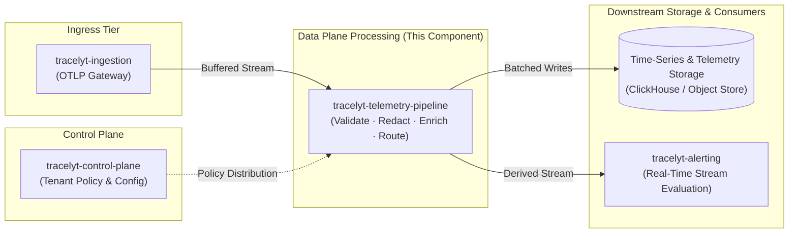

# Architecture Overview

This document describes the architectural role, design principles, and system boundaries of the **Tracelyt Telemetry Pipeline**.

> [!IMPORTANT]
> **Stage: Initial Architecture & Foundation Scaffolding (Pre-1.0)**  
> This document details the planned architectural topology and future data-processing responsibilities.  
> **No streaming topologies, Kafka brokers, or telemetry transformations are currently implemented.**

---

## 1. Why a Dedicated Telemetry Pipeline?

In modern cloud observability architectures, ingesting telemetry (distributed traces, metrics, logs) and querying it are separated by a high-throughput processing layer. Ingesting raw signals directly into persistent time-series storage without intermediate processing causes critical platform issues:

1. **Edge Overload vs. Processing Complexity**: Edge ingestion gateways (`tracelyt-ingestion`) must remain lightweight, resilient network proxies focused solely on rapid protocol termination (OTLP gRPC/HTTP), edge authentication, and fast rate limiting. Embedding complex transformation, sampling, or enrichment directly at the edge threatens edge availability.
2. **Data Cleansing and Redaction**: Telemetry often carries sensitive attributes (passwords, tokens, personal identifiers) that must be redacted or pseudonymized *before* writing to immutable long-term storage.
3. **Attribute Normalization & Metric Extraction**: Different runtime agents and SDKs emit varying resource attributes. The pipeline normalizes semantic conventions and derives aggregated metric rollups (e.g., RED metrics from spans) before storage insertion.
4. **Decoupling Ingress from Storage Latency**: Downstream columnar databases (such as ClickHouse) prefer large, batched writes. The pipeline buffers incoming streams, aggregates micro-batches, and absorbs downstream storage maintenance or transient network spikes without dropping edge connections.

---

## 2. Platform Component Context

The telemetry pipeline operates as the central data plane engine of Tracelyt, interacting with control and storage tiers:

---

## 3. Core Planned Responsibilities

| Responsibility | Architectural Description | Boundary |
| :--- | :--- | :--- |
| **Stream Ingestion & Deserialization** | Consume structured telemetry batches emitted by `tracelyt-ingestion`. | Ingress Boundary |
| **Tenant Verification & Isolation** | Enforce tenant quotas, isolate multi-tenant processing buffers, and attach verified tenant metadata. | Security Boundary |
| **Privacy Redaction & Filtering** | Strip sensitive HTTP headers, redact credentials, and drop telemetry matching configured drop filters. | Privacy Boundary |
| **Attribute Normalization** | Align resource attributes to standard OpenTelemetry semantic conventions. | Processing |
| **Batching & Micro-Aggregation** | Buffer records into optimized columnar batches for high-efficiency database insertion. | Storage Boundary |
| **Downstream Dispatch** | Deliver processed telemetry to long-term storage and real-time alerting engines with backpressure safeguards. | Egress Boundary |

---

## 4. Separation of Concerns

- **Data Plane vs. Control Plane**: The pipeline belongs exclusively to the data plane. It does not manage user authentication, UI sessions, or tenant billing. Configuration policies are pushed or polled asynchronously from `tracelyt-control-plane`.
- **Contract Governance**: Inter-service payload formats and configuration contracts are governed centrally in [`tracelyt-specs`](https://github.com/Tracelyt-Systems/tracelyt-specs). The pipeline does not invent proprietary cross-service schemas independently.
- **Storage vs. Processing**: The pipeline prepares and routes data; it does not implement database query logic, indexing algorithms, or long-term retention policies.

---

## 5. Unresolved Architectural Questions

The following decisions require empirical testing and workload baselines before implementation:
1. **Streaming Intermediary**: Whether the ingestion-to-pipeline boundary will use embedded memory ring buffers, distributed log streaming (e.g., Apache Kafka), or light pub/sub (e.g., NATS).
2. **In-Flight Batch Sizing**: Target batch sizes (record counts vs. byte limits vs. time windows) for balancing latency and columnar database write throughput.
3. **High-Throughput Language Specialization**: Whether Java 21 satisfies the target throughput/GC profile or if performance-critical worker threads justify specialized native modules (see [Technology Strategy](technology-strategy.md)).
